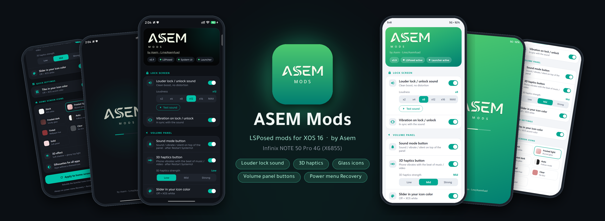
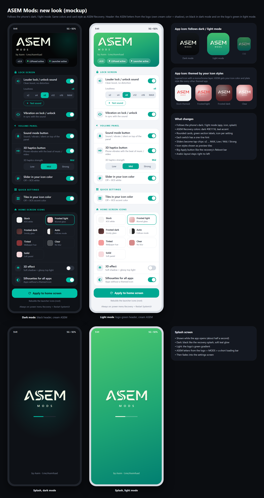

<p align="center">
<b>بسم الله الرحمن الرحيم</b><br>
<i>In the name of Allah, the Most Gracious, the Most Merciful</i>
</p>

<p align="center"></p>

<h1 align="center">ASEM Mods</h1>

<p align="center">
LSPosed mods for XOS 16 on the <b>Infinix NOTE 50 Pro 4G (X6855)</b><br>
Made by <b>Asem</b>
</p>

<p align="center">
<a href="https://t.me/Asemfuad"></a>
<a href="https://instagram.com/asem.dev"></a>
</p>

---

## Features

Everything can be switched on or off in the ASEM Mods app. Most changes apply right away, with no reboot.

### Lock screen
- **Louder lock / unlock sound**: x2, x4, x8, x12, x16 or MAX. The sound is only made louder, never distorted, so it stays clean on the speaker. Includes a **Test sound** button.
- **Vibration on lock / unlock**, timed to the sound.

### Volume panel (volume keys)
- **Per-app volume**: play YouTube while gaming, each at its own volume.
  - Apps play **together**. Starting music no longer pauses YouTube, and the other way round.
  - When 2 or more apps are playing, a **mixer button** appears. Tap it to get one slider per app, side by side in XOS style, with the **app's icon** at the bottom.
  - Each app's level is remembered and used again every time that app plays.
  - A **call** (phone, WhatsApp, Telegram…) or a **recording** (video, voice recorder, voice note) pauses every playing app.
- **Sound mode button** on top of the panel. Its icon shows the current mode (sound / vibrate / silent); tap it to switch.
- **3D haptics button**: the phone vibrates with the beat of music and videos. Strength: Low, Mid or Strong.
- **Landscape**: the 3D haptics and mixer buttons sit right under the slider (the sound mode button is hidden).
- The volume slider fill follows your icon color, and the slider icons are white.

### Quick settings
- Active tiles use your icon color (Settings > Wallpaper & personalization > Icon > Color).

### Home screen icons
- **7 icon plate styles**: Stock, Frosted light, Frosted dark, Auto (follows dark / light mode), Tinted, Clear, Solid.
- **3D effect**: soft shadow and a glossy top light.
- **Silhouettes for all apps**, so apps without a themed icon match the rest.

### Power menu
- **Recovery** and **Restart SystemUI** buttons in XOS style. Tap once, then tap again to confirm.

### The app
- Follows the phone's dark / light mode: black header in dark mode, green header in light mode.
- Status chips show whether LSPosed, System UI and the launcher are active. A red chip opens the ASEM Mods page in LSPosed.
- English and Arabic, with a right-to-left layout in Arabic.

<p align="center"></p>

## What's new in v6.1

- Fixed: the per-app volume (mixer) button sometimes didn't show in **portrait**. XOS keeps separate portrait and landscape volume panels, and now both stay up to date.

## What's new in v6.0

- **Per-app volume** in the side volume panel: a separate slider for each playing app, showing its icon.
- **Apps play together**: one media app no longer pauses another.
- Calls and recordings still pause everything.
- **Landscape** layout for the volume panel buttons.
- New **"Per-app volume button"** switch in the app (Volume panel). Turning it off puts every app back to full volume and restores normal pausing.

## Requirements

- Infinix NOTE 50 Pro 4G (X6855) on XOS 16
- Root with Magisk
- LSPosed (Zygisk)

## Install

1. Download `ASEM_Mods_vX.X_X6855.zip` from [Releases](../../releases).
2. Flash it in one of these ways:
   - **Recovery:** Install, then pick the zip.
   - **Magisk app:** Modules > Install from storage, then pick the zip.
3. Reboot.
4. In **LSPosed > Modules > ASEM Mods**, enable the module and tick **System UI** and **XOS Launcher**.
5. Reboot once more.
6. Open the **ASEM Mods** app, choose your settings, and tap **Apply to home screen** for the icon styles.

## Uninstall

Disable the module in LSPosed, or remove it in Magisk, then reboot. Everything goes back to stock XOS.

## Build

Windows with Git Bash, JDK 17+, Android SDK (platform 35, build-tools 35.0.0) and Python 3.

```bash
# signing.env (not in git): KS=<keystore path>  KS_PASS=<password>
bash build.sh      # -> build/ASEM_Mods.apk
bash make_zip.sh   # -> build/ASEM_Mods_vX.X_X6855.zip
```

## Contact

- Telegram: [@Asemfuad](https://t.me/Asemfuad)
- Instagram: [@asem.dev](https://instagram.com/asem.dev)

- To support me ♥: [paypal@AsemAyyad](https://www.paypal.com/paypalme/Mus7af)
- To join our channel in Telegram [infinix_Note50Pro](https://t.me/infinix_note50pro)


<p align="center">© Asem. All rights reserved.</p>
